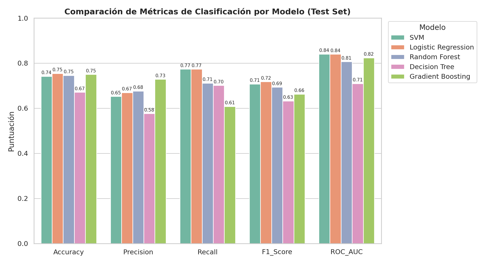
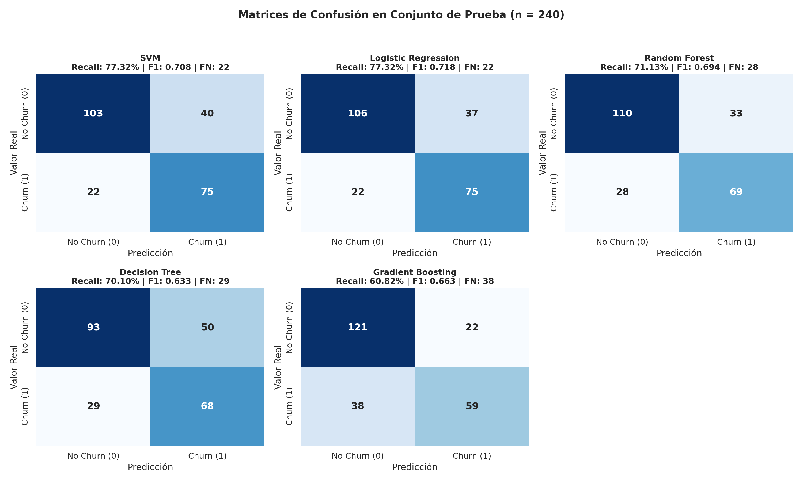
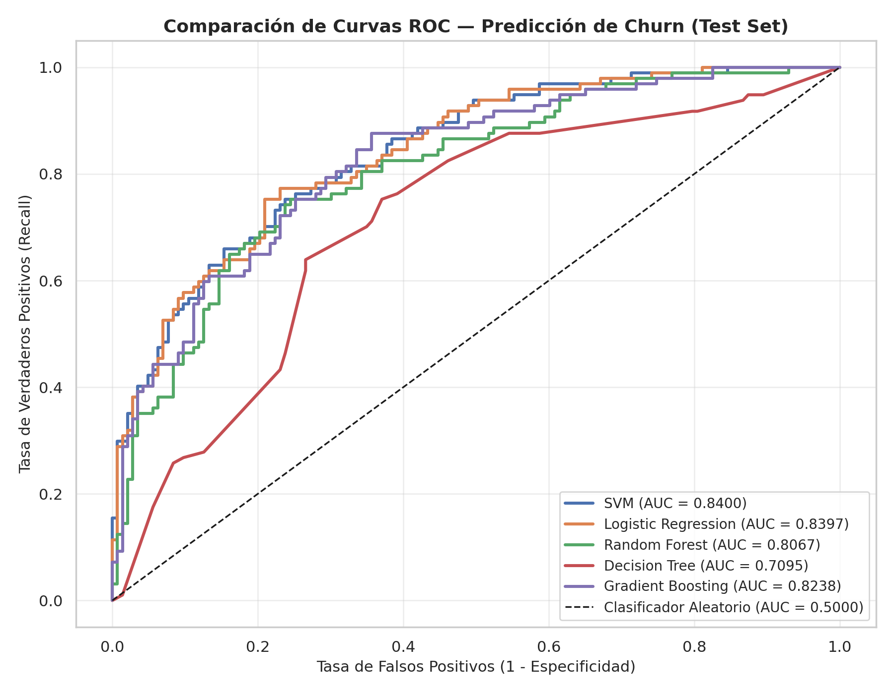
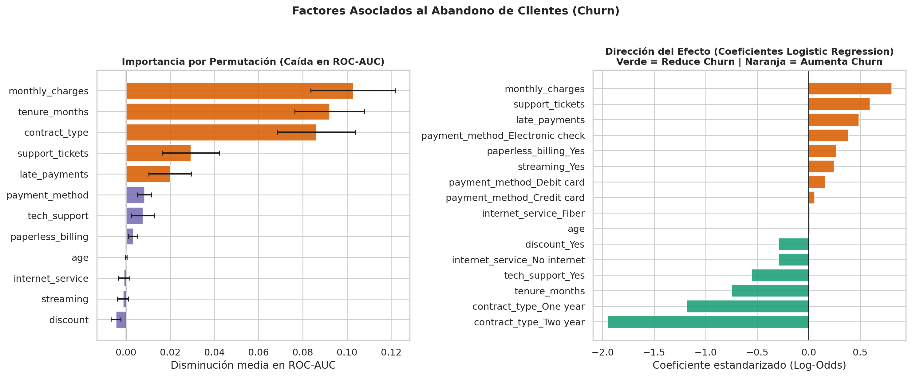

# Customer Churn Prediction & ML Optimization

End-to-end machine learning classification pipeline to predict customer churn, optimize hyperparameters without data leakage, and prioritize customer retention actions based on business cost.

## Project Overview

* **Dataset:** 1,200 customer records and 14 features (`714` non-churn / `59.50%`, `486` churn / `40.50%`).
* **Data Quality & Preprocessing:** Handled missing values across 6 columns (`age`, `tenure_months`, `monthly_charges`, `payment_method`, `internet_service`, `tech_support`), excluded `customer_id`, and applied an **80/20 stratified split** (`random_state=42`). All transformations (median/mode imputation, One-Hot Encoding, and `StandardScaler`) were encapsulated inside Scikit-Learn `Pipeline` objects fitted strictly on training data to prevent data leakage.
* **Models & Optimization:** Trained and tuned five classifiers via 5-fold stratified `GridSearchCV` optimizing `ROC-AUC` on the training set (`n = 960`), then evaluated on an untouched test set (`n = 240`).

## Model Comparison (Test Set, n = 240)

| Model | Best Hyperparameters (`GridSearchCV`) | CV ROC-AUC | Accuracy | Precision | Recall | F1-Score | Test ROC-AUC | FN / TP |
| :--- | :--- | :---: | :---: | :---: | :---: | :---: | :---: | :---: |
| **Logistic Regression** *(Recommended)* | `C=10.0, class_weight='balanced'` | 0.8190 | **75.42%** | 66.96% | **77.32%** | **0.7177** | 0.8397 | **22 / 75** |
| **SVM** | `kernel='linear', C=1.0, gamma='scale', class_weight='balanced'` | **0.8227** | 74.17% | 65.22% | **77.32%** | 0.7075 | **0.8400** | **22 / 75** |
| **Random Forest** | `n_estimators=200, max_depth=5, min_samples_split=2, class_weight='balanced'` | 0.7976 | 74.58% | 67.65% | 71.13% | 0.6935 | 0.8067 | 28 / 69 |
| **Decision Tree** | `max_depth=5, min_samples_leaf=10, min_samples_split=2, class_weight='balanced'` | 0.7340 | 67.08% | 57.63% | 70.10% | 0.6326 | 0.7095 | 29 / 68 |
| **Gradient Boosting** | `n_estimators=100, learning_rate=0.1, max_depth=2, subsample=0.8` | 0.7996 | 75.00% | **72.84%** | 60.82% | 0.6629 | 0.8238 | 38 / 59 |

## Business Recommendation

In customer retention, failing to identify a churning customer (**False Negative**) carries a much higher revenue loss than contacting a non-churning customer (**False Positive**).

* **Selected Model:** **Logistic Regression** (`C=10.0`, `class_weight='balanced'`).
* **Why it wins:** Ties with Linear SVM for the highest **Recall (`77.32%`)**, detecting **75 of 97** actual churners in the test set (`22` false negatives, `0.8397` ROC-AUC), while outperforming SVM in **Accuracy (`75.42%`)**, **Precision (`66.96%`)**, and **F1-Score (`0.7177`)** with fewer false alarms (`37` vs. `40`) and direct coefficient interpretability. By contrast, Gradient Boosting achieves higher precision (`72.84%`) but drops to `60.82%` Recall, missing `38` churners.

## Visual Results

### Metrics Comparison


### Confusion Matrices


### ROC Curves


### Feature Importance & Effect Direction


## Key Churn Drivers

1. **Contract Type (`contract_type`):** Month-to-month customers show a `51.84%` churn rate compared to `28.81%` for one-year contracts and `17.19%` for two-year contracts.
2. **Monthly Charges (`monthly_charges`):** Highest individual permutation impact on ROC-AUC; higher monthly bills without long-term lock-in increase churn risk.
3. **Tenure (`tenure_months`):** Newer customers face significantly higher churn risk; retention stabilizes as tenure grows.
4. **Operational Friction (`support_tickets` & `late_payments`):** Repeated support tickets and late payments act as strong early-warning signals of dissatisfaction.
5. **Tech Support & Payment Method:** Active tech support reduces churn (`34.32%` vs. `44.79%`), while electronic check users exhibit the highest churn rate among payment methods (`45.18%`).

## Repository Structure

* `premium_classification.py` — Reproducible end-to-end training, hyperparameter tuning, evaluation, and reporting script.
* `customer_churn_premium_dataset.csv` — Raw input dataset (`1,200` rows, `14` columns).
* `customer_churn_processed.csv` — Leak-free preprocessed dataset with train/test split labels.
* `model_comparison.csv` — Full evaluation metrics and confusion matrix counts across all 5 models.
* `optimization_results.csv` — Best hyperparameters and cross-validation ROC-AUC scores from `GridSearchCV`.
* `final_report.pdf` — Executive business report.
* `*.png` — High-resolution evaluation and feature importance charts.

## How to Run

```bash
pip install pandas numpy scikit-learn matplotlib seaborn reportlab
python premium_classification.py
